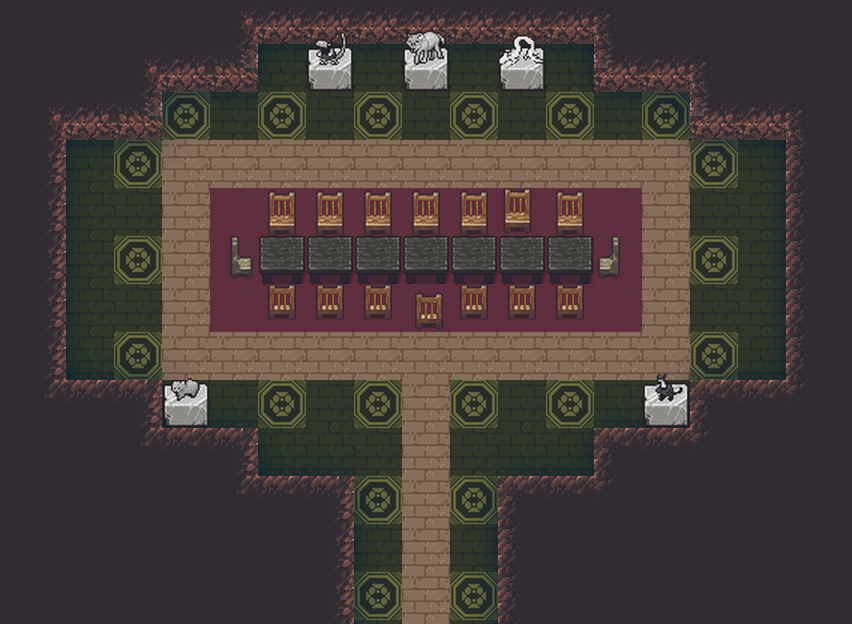
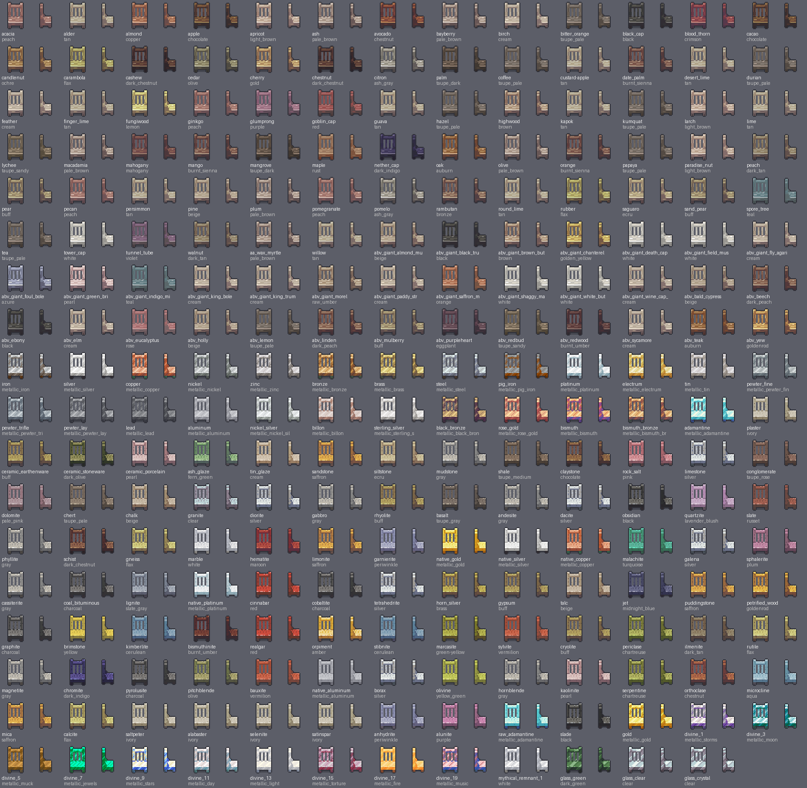
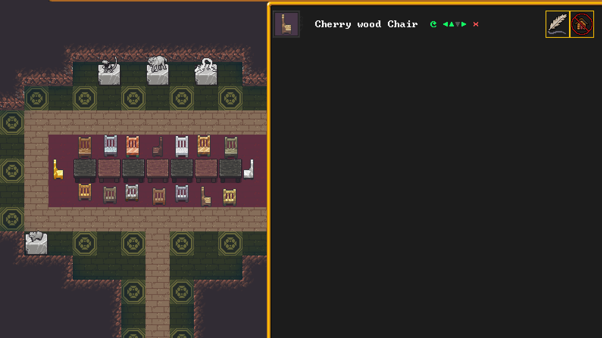

# New and Improved Chairs

A DFHack script for Dwarf Fortress that replaces the picture of chairs, built or lying in a
stockpile, with a heavy dwarven slat-back chair, and lets you turn a built one to face north,
east, south or west. All of it is purely cosmetic: the game has no notion of chair facing, so nothing about the chair or the room
changes; the save only gains a small DFHack note of each turned or moved chair. Remove the mod
and every chair looks exactly as it did before (a world generated with the mod in its mod list
is the exception, see Installation).



The chair is coloured from the material it is made of:



## Requirements

DFHack, kept up to date (Steam does that for you). The mod is plain Lua run by DFHack: there is
no compiled plugin, so it is not tied to one DFHack build. Tested on:

- Dwarf Fortress 53.17 (the Steam Windows build, run under Wine on macOS), with the graphical
  tiles
- DFHack 53.17-r1 (and 53.16-r1.1 on Dwarf Fortress 53.16)

Native Windows, Linux and Proton are untested.

## Using it



Click a chair. After its name in the view sheet there is a small circle with an arrow: click it
to turn the chair. A chair starts out facing south, toward you; each click turns it a quarter:
west, north, east and south again.

Next to it are four small triangles, `◄ ▲ ▼ ►`. Each click moves the chair's picture one
pixel that way inside its tile, to pull it up to a table for example. The chair is never clipped
or resized: a triangle goes dim once the picture has reached the edge of the tile. After a move
a red `x` appears that puts the chair back where it rests. Turning the chair also puts it back.

Where a chair rests depends on its facing: a chair facing north (seen from behind) sits 6 pixels
up, against the table north of it; one facing east or west sits 2 pixels up and 3 or 4 pixels
toward its table; one facing south sits where the art draws it. Moves count from there.

The sheet's two chair icons use the new art too: the one beside the title shows the chair as
it is turned, the one in the item list shows it from the front. Facings and positions are saved
with the fortress and come back when you load it.

From Lua (in the DFHack console, type `lua` first to get a Lua prompt):

```lua
local cf = reqscript('improved-chairs')
cf.set_facing(building_id, 0)   -- 0 N, 1 E, 2 S (the default), 3 W
cf.get_facing(building_id)
cf.set_nudge(building_id, dx, dy)   -- pixels from the resting position, +x east, +y south
cf.get_nudge(building_id)           -- dx, dy
cf.get_room(facing, 0)              -- pixels of room toward 0 N, 1 E, 2 S, 3 W
```

The mod is two DFHack overlay widgets. `improved-chairs.map` draws the chairs; `overlay disable
improved-chairs.map` gives every chair on the map the game's own picture back until you enable
it again (in a world generated with this mod in its mod list, the game's own picture is this
chair too, see Installation). `improved-chairs.sheet` is the control on the sheet, and it also swaps the sheet's two
icons; `overlay disable improved-chairs.sheet` hides both. Disable both widgets to switch the
mod off without removing it. Do not move the sheet widget: it is drawn over the sheet's title,
so a moved widget no longer lines up with the sheet.

## Installation

1. Subscribe and wait for Steam to finish downloading.
2. Fully exit the game, start it again through DFHack and load your fortress.

Existing saves work, and that is all most players need.

Optionally, since 1.1, you can also add the mod to a new world's mod list at world generation.
The mod carries the chair as an ordinary sprite sheet that takes the place of the game's chair
pictures, so in such a world the game itself draws the new chair, also with the widgets
disabled. Know before you do: treat that choice as permanent for that world. The world is tied
to the copy of the mod the game keeps under `data/installed_mods`: with that copy in place the
world loads and keeps the new chair even after you unsubscribe, and with that copy deleted as
well the game refuses to load the world ("Failed to find compatible mod"). The build menu's Chair entry
shows the new chair there too. Turning and moving chairs works the same as anywhere else.

DFHack runs scripts straight from a Workshop mod, so there is no install step. Besides
`info.txt`, the preview picture, the licence and this readme, the mod is six files, used
where they are:

```
scripts_modinstalled/improved-chairs.lua                             the script
scripts_modinstalled/internal/improved-chairs/template.lua           the chair art
scripts_modinstalled/internal/improved-chairs/chair_controls.png     the control symbols
graphics/graphics_improved_chairs.txt                                \
graphics/tile_page_improved_chairs.txt                                } the sprite sheet, used by the game only for
graphics/images/improved_chairs.png                                  /  worlds generated with the mod
```

It writes no files of its own (DFHack notes the two widgets in `dfhack-config/overlay.json`),
does not use the network, and stores each chair's facing and position in your save as a small
DFHack note.

To uninstall, unsubscribe. The game keeps its own copy of every subscribed mod, so also delete
any `new_and_improved_chairs` folder left under `mods` and `data/installed_mods` in the game's
data folder. On Windows that is `%APPDATA%\Bay 12 Games\Dwarf Fortress`, or the Dwarf Fortress
folder itself on a portable install. Do not delete them while you still play a world that was
generated with the mod in its mod list.

All messages go to the DFHack console. If chairs do not change, look there for lines starting
with `improved-chairs:`, and check that `overlay list chairs` shows both widgets
enabled.

## How it works

Every frame the game draws the map into layers of texture numbers, one cell per map tile; a
chair's picture goes in the building layer. DFHack lets an overlay widget run after the game
has filled those layers and before they reach the screen. The `improved-chairs.map` widget
puts, for each built chair in view, the texture for its material, facing and position in the
chair's cell. It does not ask the game about every chair every frame: it keeps a list of where
the chairs stand (made again when a chair is built, finished or removed, and every 600 frames
regardless) and a list of the cells in view (made again when the camera or zoom changes, when a
chair is turned or nudged, and every 30 frames regardless), so a frame costs one lookup and one
write per chair in view. Measured in a fortress with 348 chairs, 48 of them in view: 0.65 ms a
frame before 1.1, about 0.05 ms now. Chairs up to eight levels below, seen through open
space, are in the game's lower layers and get the same treatment. Creatures and items are
separate layers that the game draws over the building layer as before, so a dwarf on the
chair's tile is drawn over the chair (verified, as is scrolling).

Only a cell the game has put a building picture in is changed, so a chair the game does not
show stays unshown. A chair that is still being built is drawn as the game draws it. A chair a
dwarf has started to take apart goes back to the game's picture within 30 frames.

Where the game shows a chair item (lying in a stockpile or wherever it was dropped, as
the icon on the chair item's own sheet) it draws one of its own chair pictures: it keeps a
list of them, one for each material class, colour and state of wear or decoration, each made
the first time such a chair is shown. Since 1.1, while the `improved-chairs.map` widget is on,
every picture in that list is pointed at this mod's tile for that material, the chair facing
south. So the game itself draws the new chair in those places, with its own rules for which
item of a pile shows, and the mod does no per-chair work for them: the list is gone through
when it grows and every 30 frames. A kind of chair shown for the first time can have the
game's picture for a frame. The game's pictures are put back when the widget is disabled
(at once; a few seconds after `disable overlay`, which switches all of DFHack's overlays off)
and when the fortress is unloaded; nothing of this is saved. Things to know:

- Only built chairs can be turned and nudged. A loose chair always faces south.
- The art has one chair per material, so the marks the game adds to a worn chair or one
  studded with another material are not shown on a loose chair.
- The game does not draw a chair that a dwarf is carrying at all, so there is nothing to
  replace there.
- The chair icon in the building menu is a separate interface picture. In an existing save it
  keeps the game's chair; in a world generated with the mod it shows the new one. The stocks
  screen shows the new one everywhere.

In a world generated with the mod in its mod list, the game's pictures are made from the mod's
sprite sheet (`graphics/`) to begin with: the same chair, drawn by the game from the first
frame and also when the widget is off. The pointing above still runs there and changes nothing
you can see; a screenshot of the two side by side differs by at most 2 in 255 per colour
channel, in the ten materials tried.

Facings and nudges are stored per fortress in DFHack site data (`improved-chairs`), keyed by
building id. They are restored on map load, and entries for chairs that no longer exist are
dropped.

## The art

The script uses no sheet of finished sprites. `art/sets/slat_template.png` holds the chair once per
class of material (rows: wood, stone, metal, glass, each with its own surface texture) and
facing (columns: N, E, S, W), 32x32 pixels per tile, drawn in marker colours:

- `(t, 0, 0)` red: a shade of the material's own colour ramp
- `(0, 0, t)` blue: a shade of the first ramp, used for the legs as on the game's own chair
- everything else (outline, floor shadow, the clear openings between the slats) is kept as it is

The game holds 18 shades for every material colour, in two ramps of nine; it draws wooden
furniture with the first and stone, metal and glass with the second. The script paints the
template with those shades the first time a chair of a given material is drawn, so every
material gets its own chair and there is no table of colours to maintain. A nudged chair is
painted the same way from the template tile moved by its offset.

DFHack's Lua cannot read the pixels of a PNG, so the script reads the template from
`scripts_modinstalled/internal/improved-chairs/template.lua`, which `art/make_template.py`
writes from the PNG (it needs Python with Pillow). To try a changed template in a running game, run
`art/make_template.py`, copy `template.lua` over the installed one and run
`improved-chairs reload`. `improved-chairs status` prints how many chair tiles have been
painted and drawn.

The sprite sheet for newly generated worlds, `graphics/images/improved_chairs.png`, is written
from the same template by `art/make_sheet.py`: the south-facing chair of each material class,
its marker tones turned into the shades of the game's default palette, which the game then
recolours per material as it does its own furniture. The outline is one step off the palette's
darkest shade so that the game leaves it alone, as the script does.

## Tests

```sh
lua test/run_tests.lua      # any Lua 5.3 or later; DFHack and the game are stubbed
```

The tests cover the painting (tones, see-through pixels, moved tiles), the room a chair has in
its tile, the saved data (reading, the conversion of old saves, dropping chairs that are gone)
which map cell a chair is drawn in, and the game's own chair pictures (pointed at the mod's
tiles, put back when the widget or all of DFHack's overlays are switched off and when the
world is unloaded). They also check that the sprite sheet's definitions name every chair
picture of the game and the right cell for each.

## Layout and releasing

The repository is the mod folder: `info.txt`, `preview.png`, `scripts_modinstalled/` and
`graphics/` are what the game and DFHack read. `art/`, `test/` and `docs/` are left out of archives made with
`git archive` (see `.gitattributes`), so an exported copy is exactly what gets uploaded.

1. Run the checks: `lua test/run_tests.lua`, `python3 art/make_template.py --check` (the Lua
   template matches the PNG), `python3 art/make_sheet.py --check` (so does the sprite sheet) and
   `cmp art/controls.png scripts_modinstalled/internal/improved-chairs/chair_controls.png`.
2. In `info.txt`, raise `NUMERIC_VERSION` (keep it three digits: DFHack compares it as text and
   uses the highest copy it finds) and `DISPLAYED_VERSION`, and write a new `STEAM_CHANGELOG`.
   Commit.
3. Export the mod into the game's upload folder and upload from the Mods screen:
   `git archive --prefix=new_and_improved_chairs/ HEAD | tar -x -C "<game data>/mods/mod_upload"`
4. After the first upload the game adds a `STEAM_FILE_ID` line to the uploaded `info.txt`. Copy
   that line into `info.txt` here; without it the next upload creates a second Workshop item.
5. The Workshop page's description is `steam_description.txt`; paste it on the page after
   changing it. `info.txt` has no `STEAM_DESCRIPTION` line on purpose: with one, every upload
   would replace the page's description with that line.

## Known limitations

- The controls are placed from where the sheet title starts, 90 columns from the right edge
  of the interface. An interface change that moves the title would leave them behind.
- A nudge moves only the chair's picture. A dwarf sitting on the chair is drawn by the game where
  it always is, in the middle of the tile, so a chair moved far to one side sticks out beside
  its sitter.
- A chair cannot be nudged out of its tile: the game lets a building draw only on its own tile.
  How far it can go from its resting position depends on the view: up to 13 pixels sideways for
  a chair seen from the side, 1 pixel up or down for a chair facing south, which nearly fills
  the height of the tile, and not up at all for a chair facing east or west.
- The script reads the game's map layers, its lists of chairs and its next-building counter
  (`building_next_id`) by the names DFHack gives them. A game update that
  changes how the map is drawn can stop the chairs from changing until the script is updated;
  the game's own chairs show in the meantime.
- On DFHack 53.16-r1.1 and older, chairs turned or nudged in a reclaimed fortress before its
  first save reach the save file only with the second save: save once more before quitting.
  DFHack 53.16-r2 and later should not have this gap (reclaiming was not tested on them).
- Fortress mode with the graphical tiles only; the ASCII (text) mode is not supported. In
  adventure mode chairs are drawn by the game; visiting your old fort as an adventurer leaves
  the stored facings untouched but does not draw them.

## Licence

MIT; see [LICENSE](LICENSE).
